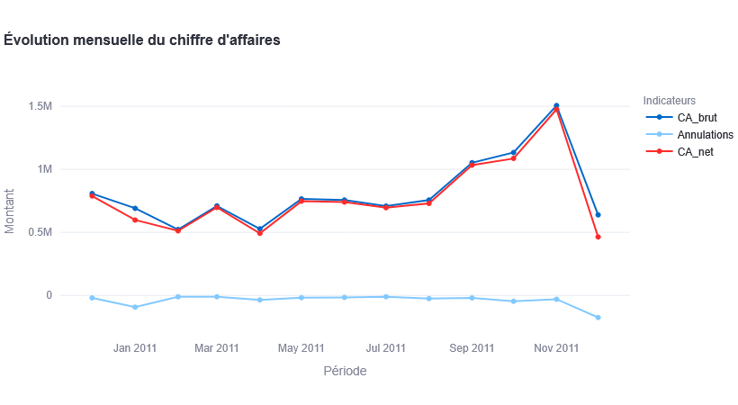
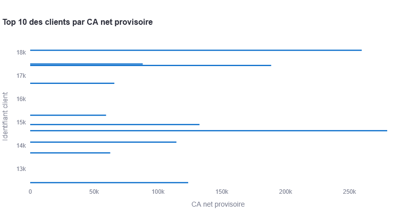
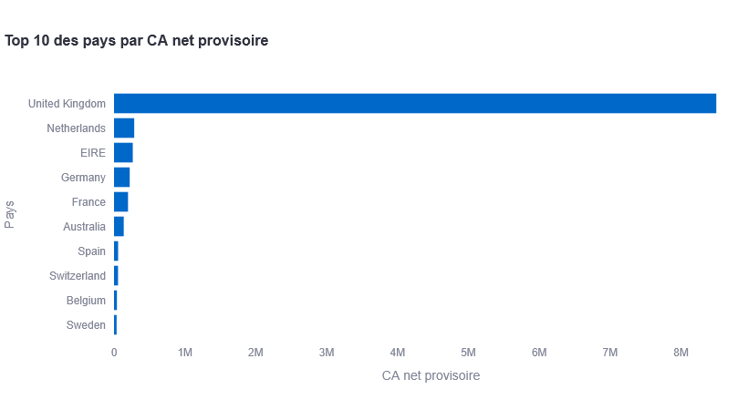

# Tableau de bord décisionnel des ventes

**Application interactive d'analyse des performances commerciales développée avec Python, Pandas, Streamlit et Plotly.**

[](https://www.python.org/)
[](https://pandas.pydata.org/)
[](https://streamlit.io/)
[](https://plotly.com/)

## 1. Présentation

Ce projet consiste à concevoir et développer un tableau de bord décisionnel destiné au suivi et à l'analyse des performances commerciales.

À partir du jeu de données **Online Retail**, l'application transforme les données transactionnelles en indicateurs et visualisations permettant d'étudier les ventes, les produits, les clients et les marchés géographiques.

L'objectif est de faciliter l'interprétation des performances commerciales et d'appuyer la prise de décision à partir des données.

## 2. Objectifs du projet

- Analyser l'évolution du chiffre d'affaires.
- Mesurer l'impact des annulations commerciales.
- Identifier les produits les plus performants.
- Étudier les performances des clients identifiés.
- Comparer les résultats commerciaux par pays.
- Concevoir une interface interactive de visualisation des données.

## 3. Technologies utilisées

| Technologie | Utilisation |
|---|---|
| Python | Développement et traitement des données |
| Pandas | Manipulation et analyse des données |
| NumPy | Opérations numériques et classification |
| Streamlit | Développement du tableau de bord |
| Plotly | Visualisations interactives |
| OpenPyXL | Lecture des fichiers Excel |
| Jupyter Notebook | Exploration et analyse des données |
| Git / GitHub | Gestion de versions et hébergement du code |

## 4. Source des données

**Jeu de données :** Online Retail  
**Source :** UCI Machine Learning Repository  
**Lien :** https://archive.ics.uci.edu/dataset/352/online+retail

Le jeu de données contient 541 909 lignes et 8 variables initiales.

Les principales variables sont :

| Variable | Description |
|---|---|
| InvoiceNo | Numéro de facture |
| StockCode | Référence du produit |
| Description | Description du produit |
| Quantity | Quantité commandée |
| InvoiceDate | Date de facturation |
| UnitPrice | Prix unitaire |
| CustomerID | Identifiant du client |
| Country | Pays |

Le fichier Excel brut n'est pas inclus dans le dépôt GitHub. Il doit être téléchargé séparément depuis la source officielle.

## 5. Fonctionnalités

L'application comporte cinq espaces fonctionnels.

### Vue générale
- Indicateurs clés de performance (KPI).
- Chiffre d'affaires brut.
- Annulations commerciales.
- Chiffre d'affaires net provisoire.
- Panier moyen brut.
- Taux de déduction des annulations.
- Évolution mensuelle des ventes.

### Analyse des produits
- Classement des 10 produits par chiffre d'affaires net provisoire.
- Classement des 10 produits par quantité vendue.
- Consultation des performances détaillées.

### Analyse des clients
- Classement des 10 principaux clients par chiffre d'affaires net provisoire.
- Nombre de factures.
- Quantités vendues.

### Analyse géographique
- Classement des pays par chiffre d'affaires net provisoire.
- Nombre de factures et de clients identifiés.
- Quantités vendues.

### Données et méthodologie
- Aperçu des transactions.
- Informations sur les données.
- Présentation des limites méthodologiques.

### Filtres interactifs

Les utilisateurs peuvent filtrer les analyses selon :
- Une période donnée.
- Un ou plusieurs pays.

## 6. Résultats de référence

Sur l'ensemble du jeu de données, les indicateurs calculés sont :

| Indicateur | Résultat |
|---|---:|
| CA brut | 10 574 813,18 |
| Annulations commerciales | -514 746,44 |
| CA net provisoire | 10 060 066,74 |
| Factures de vente | 19 866 |
| Factures d'annulation | 3 638 |
| Clients identifiés | 4 335 |
| Panier moyen brut | 532,31 |
| Taux de déduction des annulations | 4,87 % |
| Quantités vendues | 5 581 150 |
| Références de marchandises vendues | 3 918 |

*Les montants sont exprimés dans l'unité monétaire du jeu de données.*

## 7. Aperçu de l'application

### Évolution mensuelle du chiffre d'affaires



### Top 10 des clients



### Top 10 des pays



## 8. Architecture du projet

```text
tableau-de-bord-ventes/
│
├── app/
│   └── dashboard.py
│
├── docs/
│   └── dictionnaire_donnees.md
│
├── notebooks/
│   └── 01_analyse_preparation.ipynb
│
├── screenshots/
│   ├── Capture d'écran ...
│   ├── plot-image.png
│   ├── plot-image1.png
│   ├── top-10-des-clients-par-ca-net-provisoire.png
│   ├── top-10-des-pays-par-ca-net-provisoire.png
│   └── évolution-mensuelle-du-chiffre-daffaires.png
│
├── src/
│   ├── data_loader.py
│   ├── data_processing.py
│   ├── kpi.py
│   └── analytics.py
│
├── .gitignore
├── requirements.txt
└── README.md
```

Le dossier `data/raw/` est créé localement pour accueillir le fichier Excel. Il est exclu du dépôt Git.

## 9. Installation et exécution

### Prérequis

- Python.
- Git.
- Connexion Internet pour télécharger les dépendances et le jeu de données.

### Étape 1 — Cloner le dépôt

```bash
git clone https://github.com/LidXo/tableau-de-bord-ventes.git
```

### Étape 2 — Accéder au projet

```bash
cd tableau-de-bord-ventes
```

### Étape 3 — Créer un environnement virtuel

```bash
python -m venv .venv
```

### Étape 4 — Activer l'environnement sous Windows

```powershell
.venv\Scripts\Activate.ps1
```

### Étape 5 — Installer les dépendances

```bash
pip install -r requirements.txt
```

### Étape 6 — Préparer les données

Télécharger le fichier Online Retail depuis le dépôt officiel UCI et le placer dans :

```text
data/raw/Online Retail.xlsx
```

### Étape 7 — Lancer l'application

```bash
python -m streamlit run app/dashboard.py
```

L'application s'ouvre dans le navigateur.

## 10. Précautions méthodologiques

Le chiffre d'affaires net affiché est un **indicateur provisoire**, construit à partir de règles de classification des transactions.

Les règles appliquées distinguent notamment :
- Les ventes standard.
- Les annulations commerciales.
- Les opérations manuelles.
- Les frais de plateforme.
- Les ajustements comptables.
- Les mouvements non commerciaux.
- Les transactions à prix nul.

Autres limites :

- Les doublons exacts sont conservés, car leur nature commerciale ne peut pas être confirmée.
- Les transactions sans identifiant client peuvent contribuer au chiffre d'affaires global, mais ne sont pas attribuées à un client identifié.
- Les périodes de décembre 2010 et décembre 2011 sont partielles.
- Les coûts d'achat et les charges de l'entreprise ne sont pas disponibles. Il est donc impossible de calculer le bénéfice.

## 11. Perspectives d'amélioration

- Ajouter des tests automatisés.
- Améliorer les fonctionnalités d'exportation.
- Optimiser les performances de traitement.
- Déployer l'application sur une plateforme cloud.
- Enrichir les analyses avec de nouvelles sources de données.

## 12. Statut du projet

**Statut : application fonctionnelle et publiée sur GitHub.**

Le projet couvre l'exploration des données, leur préparation, le calcul des indicateurs commerciaux et la création d'un tableau de bord interactif.

**Dépôt GitHub :** https://github.com/LidXo/tableau-de-bord-ventes

**Technologies principales :** Python · Pandas · NumPy · Streamlit · Plotly